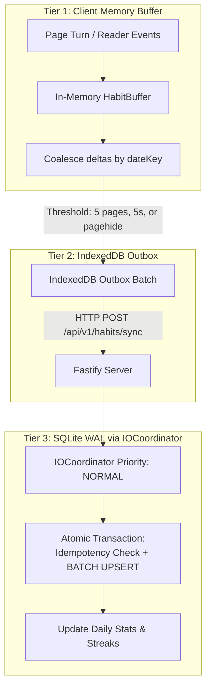

# Sprint 30 Senior Architectural Blueprint: Reading Goals, Habit Tracking & Write-Behind Protection

> **Source:** Direct Consultation with ChatGPT via Brave MCP Session (`Colaboración en proyecto - Brave`).
> **Hardware Profile:** Intel Pentium T4500 (2 cores @ 2.30 GHz), Intel GMA 4500MHD GPU, 4TB SATA II HDD (5400 RPM).

---

## 1. Domain Model: Clear Separation of Concerns
1. **Configured Goal (`user_reading_goals`):** What the user wants to achieve (e.g. 30 pages/day or 20 minutes/day).
2. **Recorded Activity (`user_daily_activity`):** What was actually read on each day (pages read, active reading seconds).
3. **Daily Outcome (`goal_completed`, `completed_at`):** Whether the goal was completed and when.
4. **Historical Integrity:** Store `target_type` and `target_value` as evaluated for each historical date so future goal updates don't alter past completion statuses.

---

## 2. 3-Tier Storage Hierarchy for Write-Behind Protection
On the Intel Pentium T4500 and 5400 RPM SATA II HDD, issuing a synchronous disk write per page flip will destroy HDD IOPS and saturate CPU in I/O wait.

### Flush Policies:
- **Accumulated Threshold:** 5 pages or 5 seconds since first event.
- **Inactivity Timeout:** 20 seconds of idle reading.
- **Lifecycle Events:** Chapter change, `visibilitychange` to hidden, and `pagehide`.
- **Offline / Failure Recovery:** IndexedDB outbox retains batch until server returns 200 OK with `batchId`.

---

## 3. Intel GMA 4500MHD UI Rules for `DailyGoalRing`
To guarantee 60 FPS without micro-stutter on the legacy integrated GPU:
- **STRICTLY FORBIDDEN:**
  - SVG filters (`<filter>`, `<feGaussianBlur>`).
  - Animated CSS `box-shadow` or `drop-shadow`.
  - `backdrop-filter: blur(...)`.
  - Continuous `requestAnimationFrame` loops.
  - Re-rendering every second when goal is page-based.
- **MANDATED PATTERN:**
  - Simple 2-circle SVG with `strokeDashoffset` CSS transition (`transition: stroke-dashoffset 0.4s ease`).
  - `contain: layout paint` on container.
  - Decoupled state: `DailyGoalRing` only re-renders when habit metrics change, not when reader flips pages.

---

## 4. Notifications Architecture
- **In-App Toast:** Primary and universal, animated via GSAP (scale pop), shown exactly once per day upon goal completion.
- **Web Notification:** Optional via `Notification.requestPermission()`. Triggered on `goal_completed`, deduplicated via `tag: 'goal-completed-YYYY-MM-DD'`.
