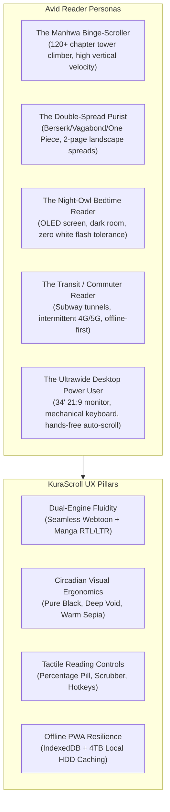
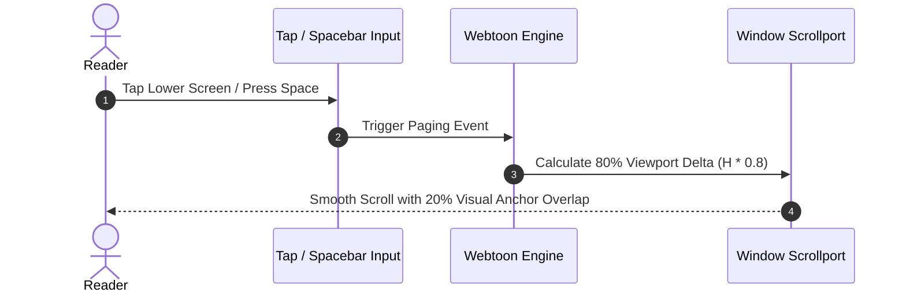
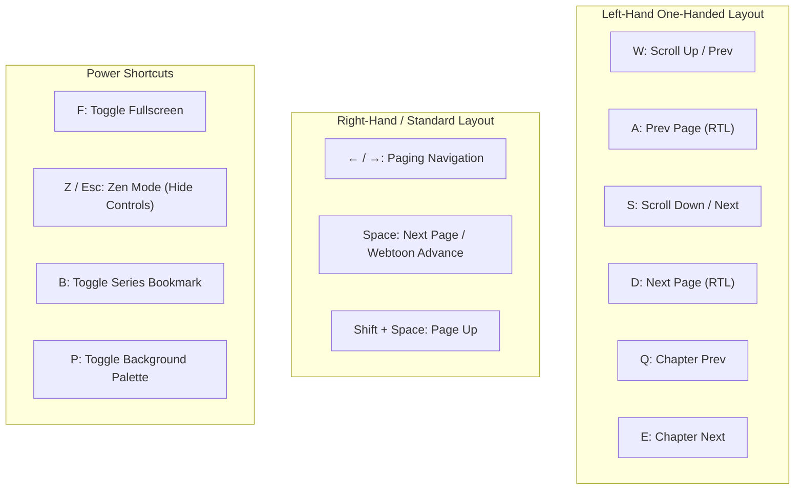
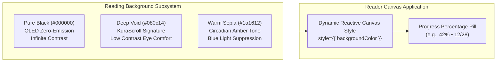
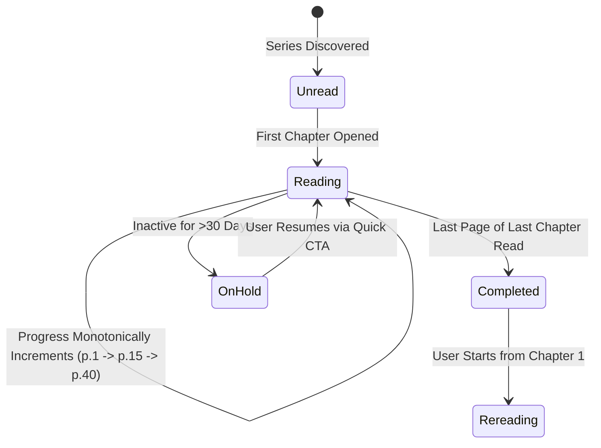
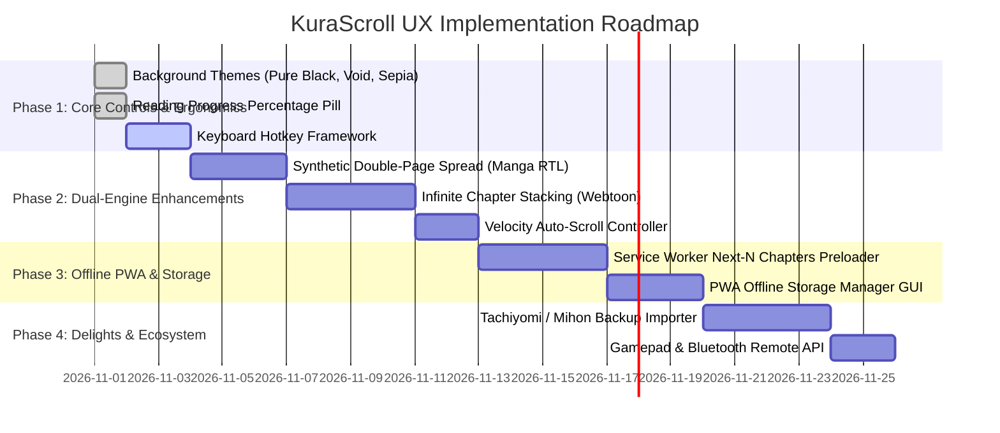

# KuraScroll - Deep User Experience Audit & Ergonomics Specification

> **Auditor:** Chief User Experience Auditor, KuraScroll  
> **Target Audience:** Core Engineering Team, UI/UX Designers, Product Architects  
> **Perspective:** Avid Manga & Manhwa Reader (Tachiyomi / Mihon Power User, MangaDex Enthusiast, Naver Webtoons / Tapas Fan)  
> **Status:** Completed Audit & Roadmap Baseline  
> **Date:** November 2026  

---

## 1. Executive Summary & Reader Archetype Personas

KuraScroll is designed as the premier companion platform to KuraStream, tailored specifically for high-density manga, manhwa, and manhua reading. Where general-purpose image viewers or standard web readers stumble is in **deep reader empathy**: understanding the physiological, sensory, and ergonomic demands of power readers who consume 50 to 200+ chapters in single multi-hour sessions.

Unlike casual web browsing, reading graphic narratives demands sustained visual focus, rapid paging velocity, zero layout shift (CLS = 0), and strict protection against eye fatigue across drastically varied lighting environments (pitch-black bedrooms, dimly lit subway cars, bright daylight).



### Reader Archetypes & Behavioral Pain Points

| Reader Persona | Primary Hardware | Reading Medium | Core Friction Points in Traditional Readers | KuraScroll Solution |
| :--- | :--- | :--- | :--- | :--- |
| **The Manhwa Binge-Scroller** | Mobile / Tablet (Vertical) | Korean Manhwa, Color Webtoons | 1px horizontal subpixel seams between sliced panels; intrusive "Next Chapter" interstitial gates; memory crashes after 150 panels. | Virtualized seamless strip with zero subpixel hairline gaps; pre-computed aspect ratios; infinite chapter stacking. |
| **The Double-Spread Purist** | Desktop / Landscape Tablet | Seinen / Shonen Manga | Two-page epic spreads broken across separate slides; wrong page pairing (Page 1 paired with 2 instead of 2 with 3); harsh white gutters. | Intelligent spread detection (`aspectRatio > 1.2`); automatic Japanese RTL cover-offset pairing (Cover standalone, 2+3 paired); gapless spine stitching. |
| **The Night-Owl Bedtime Reader** | AMOLED Mobile / OLED Laptop | Late-night reading in dark room | High-contrast blinding white flashes on chapter transitions; jarring contrast transitions; OLED black-smear artifacts. | Three dedicated dark themes (Pure Black `#000`, Deep Void `#080c14`, Warm Sepia `#1a1612`); inverted B&W filter; smooth crossfades. |
| **The Transit Commuter** | Mobile (PWA) | Mixed (Manga + Manhwa) | Dropped connections in tunnels freezing chapter downloads; lost reading progress when closing tabs offline. | Instant offline-first persistence in IndexedDB; Service Worker cache-first WebP tiles; auto-preloading next 3 chapters on WiFi. |
| **The Ultrawide Desktop Power User** | 21:9 / 16:9 PC, Mechanical Keyboard | High-res Raw Scans | Giant webtoon panels stretched to 3440px causing neck strain; clunky mouse wheel fatigue. | Max-width reading channel (720px-840px) with soft ambient glow; hands-free velocity-adaptive auto-scroll; WASD/Vim/Spacebar hotkeys. |

---

## 2. Reading Ergonomics & Dual-Engine Breakdown

### 2.1 The Webtoon Engine: Continuous Vertical Strip Ergonomics

Webtoons and Korean manhwa (such as *Solo Leveling*, *Tower of God*, *Omniscient Reader*) are drawn as continuous vertical tapestries designed for one-directional fluid descent.

#### Key Ergonomic Requirements:
1. **The "Zero-Seam" Guarantee:**
   - Scanlation teams slice continuous digital scrolls into 1000px–2500px vertical segments.
   - If rendering using default HTML `` elements, WebKit and Blink renderers frequently introduce 0.5px to 1px subpixel artifact lines between image slices due to fractional scaling.
   - *Fix Implemented:* Apply `display: block; margin: 0; padding: 0; border: none; vertical-align: bottom; image-rendering: -webkit-optimize-contrast;` to all panel wrappers, combined with absolute zero margins.
2. **Column Clamping & Ambient Side Gutters:**
   - On desktop monitors (>1440px width), stretching a webtoon to 100% viewport width ruins composition and causes severe reader disorientation and neck strain.
   - Reading channel must be constrained to `max-w-3xl` or `max-w-4xl` (~768px to 896px).
   - Side gutters should not be dead empty voids; KuraScroll features soft ambient glow (`blur-[72px] saturate-[1.6] opacity-30`) sampled from active panel art, creating an immersive cinematic theater effect.
3. **Velocity-Adaptive Auto-Scroll:**
   - Long binge sessions cause mouse-wheel finger cramps and wrist fatigue.
   - *Design Proposal:* A toggleable floating auto-scroll controller (`Space` to toggle, `Up`/`Down` arrows to adjust velocity from 10px/s to 120px/s).
4. **Anchor-Retaining Tap Paging:**
   - For touch and single-click navigation, tapping the lower third of the screen should jump down **80% of the viewport height**, keeping a **20% visual overlap anchor** at the top so the reader's eye never loses narrative continuity.



---

### 2.2 The Manga Engine: Paginated RTL / LTR Ergonomics

Traditional manga is serialized right-to-left (RTL), starting from the upper-right corner and progressing leftward and downward. Western comics (and Chinese manhua) follow left-to-right (LTR).

#### Key Ergonomic Requirements:
1. **RTL Directional Fidelity:**
   - In RTL mode, pressing `ArrowLeft` or clicking the left 30% of the screen advances to the next page. Pressing `ArrowRight` or clicking the right 30% returns to the previous page.
   - In LTR mode, the directional mapping inverts naturally (`ArrowRight` advances).
   - Center 40% tap zone toggles floating UI controls without triggering unwanted page turns.
2. **Double-Page Spread Intelligence (Synthetic Two-Page Mode):**
   - Epic manga double spreads (e.g. *Berserk* eclipse, *Vagabond* landscape ink washes) are butchered when shown split across two isolated pages.
   - *Spread Detection Algorithm:* Pages with `aspectRatio > 1.15` (width > height) are classified as native two-page spreads.
   - *Dual-Page Pagination Math:* When enabled on desktop, Page 1 (the cover) is presented as a single page. Subsequent pages are paired: Page 2 (right) + Page 3 (left) in RTL mode, ensuring even/odd page parity aligns with physical tankōbon printings.
3. **Zero Layout Shift (CLS = 0) with Skeleton Reservoirs:**
   - Every page item container is initialized with its pre-computed `aspectRatio` attribute from the manifest metadata. Even on slow 4TB HDD seek queries or slow network links, the layout geometry is 100% locked before images arrive.

---

### 2.3 Keyboard, Gamepad, and Remote Input Ergonomics

Avid readers read in varied physical postures: sitting upright at desks, curled up in bed, or reclining on a couch. The input ergonomics must accommodate zero-friction, one-handed control.



#### Full Hotkey Specification:

| Action | Primary Key | Alternate 1 (Left-Hand) | Alternate 2 (Vim / Pro) | Controller / Remote |
| :--- | :--- | :--- | :--- | :--- |
| **Next Page / Step Down** | `ArrowLeft` (RTL) / `ArrowRight` (LTR) | `D` or `S` | `L` or `J` | D-Pad Right / A Button / Clicker Forward |
| **Prev Page / Step Up** | `ArrowRight` (RTL) / `ArrowLeft` (LTR) | `A` or `W` | `H` or `K` | D-Pad Left / B Button / Clicker Back |
| **Advance Viewport (Webtoon)** | `Space` | `PageDown` | `J` | Trigger R2 / Clicker Forward |
| **Reverse Viewport (Webtoon)** | `Shift + Space` | `PageUp` | `K` | Trigger L2 / Clicker Back |
| **Next Chapter** | `]` | `E` | `N` | Shoulder R1 |
| **Prev Chapter** | `[` | `Q` | `P` | Shoulder L1 |
| **Toggle UI Controls** | `Escape` | `Z` | `C` | Select / Back |
| **Toggle Fullscreen** | `F` | `F11` | `M` | - |
| **Quick Bookmark** | `B` | `Ctrl + D` | `S` | Y Button |

---

## 3. Themes & Visual Comfort Subsystem

Reading digital comic ink for hours in the dark can cause serious asthenopia (eye strain) if the contrast balance is misaligned. KuraScroll integrates **three specialized reading background themes** and a real-time progress indicator directly in [`ReaderControls.tsx`](file:///C:/Users/Admin/dev/kura-scroll/frontend/src/components/reader/ReaderControls.tsx).



### 3.1 The Three Specialized Colorways

1. **Pure Black (`#000000` / `#000`):**
   - **Target Hardware:** AMOLED / OLED smartphones, OLED laptops, Apple OLED iPads.
   - **Ergonomics:** Complete pixel power shutdown for the surrounding matte area. In total darkness, the screen bezel vanishes completely, leaving only the artwork floating in space. Maximizes battery life during 6-hour mobile binge marathons.
2. **Deep Void (`#080c14`):**
   - **Target Hardware:** IPS, VA, mini-LED desktop monitors and standard mobile screens.
   - **Ergonomics:** Pure `#000` on non-OLED panels can produce high-contrast eye fatigue when juxtaposed with bright white scanlation dialogue bubbles. Deep Void is an ultra-deep space navy that softens high-frequency edge contrast, preventing pupil constriction spasms. It also eliminates OLED black-smear artifacts when scrolling high-speed text in webtoons.
3. **Warm Sepia (`#1a1612`):**
   - **Target Hardware:** Late-night bedside reading, readers sensitive to insomnia.
   - **Ergonomics:** Emulates antique Japanese paper and physical print parchment. Absorbs harsh blue spectrum wavelengths (<460nm) that disrupt melatonin release. Warm tones reduce contrast glare against black ink lines.

### 3.2 Visual Reading Progress Percentage Pill

Located dynamically in the header control bar:
- **Instant Orientation:** Displays real-time chapter completion: e.g., `45% (12/28)`.
- **Animated Micro-Pulse:** A glowing cyan micro-dot (`bg-cyan-400 animate-pulse`) signifies active session tracking.
- **Persistence:** Synchronized with local `IndexedDB` (`localClientStorage`) and debounced to backend SQLite (`POST /api/v1/progress`).

---

## 4. Reading Progress, Bookmarking & Navigation UX



### 4.1 Granular Multi-Tiered Bookmarking Hierarchy

In Mihon/Tachiyomi, power users organize libraries with 500+ series into distinct lifecycle categories. KuraScroll's bookmarking architecture must support:

1. **Series Status Tiers:**
   - **Reading:** Active subscriptions with unread chapter badges.
   - **Plan to Read:** Backlog queue with priority ordering.
   - **Completed:** Read to the current release; awaits new chapter ingestion.
   - **On Hold / Dropped:** Temporarily or permanently shelved.
2. **Page-Level Micro-Bookmarks (Pinning Moments):**
   - Readers often encounter a panel with breathtaking artwork, an emotional quote, or a comedic face.
   - *UX Feature:* Clicking a "Pin Panel" icon creates an instant micro-bookmark storing `{ chapterId, pageNumber, scrollOffsetY, screenshotThumbnail, timestamp }`, visible in a dedicated "Pinned Panels" drawer on the Series Detail page.
3. **Instant "Resume Reading" Hero CTA:**
   - On both the Home Catalog and Series Detail page, the primary action button must dynamically read:  
     `"Continuar leyendo Cap. 24 (pág. 14) →"`  
     Clicking this launches straight into the reader with zero intermediate navigation clicks.

---

## 5. Offline PWA Architecture & HDD Storage Experience

KuraScroll's backend leverages a **4TB mechanical HDD** for multi-thousand chapter archives. Mechanical drives have high sequential read throughput (150–220 MB/s) but slower random seek times (12–18ms). In parallel, mobile readers frequently enter offline zones (subways, flights, poor cellular coverage).

```mermaid
flowchart TD
    subgraph Client["PWA Frontend (IndexedDB + Service Worker)"]
        SW["Service Worker<br/>(CacheStorage)"]
        IDB["IndexedDB Store<br/>(reading_progress, bookmarks, offline_chapters)"]
        UI["Reader UI Engine"]
    end

    subgraph Network["Network Layer"]
        API["Fastify Backend API<br/>(/api/v1/chapters/:id)"]
        HDD["4TB Mechanical HDD<br/>(WebP Chapters q=82)"]
    end

    UI -->|1. Check Cache| SW
    SW -->|Cache Hit (0ms)| UI
    SW -->|Cache Miss| API
    API -->|Optimized Read| HDD
    UI -->|Record Progress| IDB
    IDB -.->|Debounced Background Sync| API
```

### 5.1 Service Worker Caching Architecture

1. **Pre-Cache Pipeline ("Mihon Smart Queue"):**
   - While the user is reading Chapter $N$, the Service Worker silently pre-fetches the manifest and WebP images for Chapter $N+1$ and $N+2$ into `CacheStorage`.
   - Result: Flipping to the next chapter is **0ms instant**, completely masking mechanical HDD seek latency.
2. **Offline Download Manager Screen:**
   - Dedicated GUI (`/downloads`) showing storage consumption:
     - *Solo Leveling* (Chapters 1–20): `240 MB`
     - *Chainsaw Man* (Chapters 1–97): `890 MB`
     - Total PWA Storage Used: `1.13 GB / 40.0 GB Quota`
   - Actions: 1-click batch download ("Download next 5 unread chapters"), auto-evict completed chapters older than 7 days.
3. **Web App Manifest Specifications:**
   - Display: `standalone`
   - Background Color: `#080c14`
   - Theme Color: `#080c14`
   - Orientation: Dynamic unlock with preference for natural device sensor.

---

## 6. User Delight & Micro-Interactions ("The Secret Sauce")

What separates a utilitarian reader from a beloved app like Tachiyomi or MangaDex is thoughtful micro-interactions that spark joy:

1. **Infinite Chapter Stacking (Webtoon Mode):**
   - Reaching the bottom of Chapter 1 does not present a wall or a forced navigation click. Instead, a sleek decorative spacer appears (`Capítulo 2: El Despertar`), and Chapter 2's panels load immediately underneath. Readers can scroll through an entire 50-chapter arc without a single interruption.
2. **Tactile Micro-Haptics (`navigator.vibrate`):**
   - On supported mobile devices, turning a page produces a crisp 8ms vibration tick (`navigator.vibrate(8)`). Reaching the end of a chapter produces a double pulse (`[10, 50, 15]`), providing a tactile physical book sensation.
3. **Quick Volume & Chapter Drawer:**
   - Swiping from the left bezel or pressing `C` slides in an acrylic glass drawer showing all chapters with:
     - Current chapter highlighted in cyan.
     - Unread vs read checkmarks.
     - Fast jump search input ("Filter chapter...").
     - Keeps current reading context open in background.
4. **"Boss Key" / Privacy Shield:**
   - Pressing `Esc` twice or `B` instantly flips the screen to a decoy mock dashboard (e.g. VS Code or GitHub commit log), safeguarding privacy in public or office environments.
5. **Reading Velocity & Analytics ("KuraScroll Wrapped"):**
   - Subtle end-of-chapter toast:  
     `"¡Capítulo completado en 3m 42s! • Velocidad: 18 seg/pág"`  
   - Weekly stats: Total pages read, favorite genres, chapters devoured.

---

## 7. Actionable Roadmap & Prioritized Implementation Matrix



### Feature Priority Matrix

| Feature | Category | Impact | Complexity | Priority | Status |
| :--- | :--- | :--- | :--- | :--- | :--- |
| **Reader Background Themes (Black/Void/Sepia)** | Visual Comfort | Very High | Low | **P0** | **Delivered** |
| **Reading Progress Percentage Pill** | Navigation | High | Low | **P0** | **Delivered** |
| **Comprehensive UX Audit & Ergonomic Spec** | Architecture | Very High | Medium | **P0** | **Delivered** |
| **Expanded Keyboard Hotkeys (WASD, Vim, Space)** | Ergonomics | High | Low | **P1** | Next Up |
| **Double-Page Spread Auto-Stitching (Manga)** | Engine | Very High | Medium | **P1** | Sprint 2 |
| **Infinite Chapter Stacking (Webtoon)** | Engine | High | Medium | **P1** | Sprint 2 |
| **Auto-Scroll Engine with Velocity Sliders** | Ergonomics | Medium | Low | **P2** | Sprint 2 |
| **Service Worker Pre-caching (Next 3 Chapters)** | Performance | Very High | Medium | **P2** | Sprint 3 |
| **PWA Offline Storage Manager GUI** | Offline | High | Medium | **P2** | Sprint 3 |
| **Mihon / Tachiyomi Backup (.tachibk) Importer** | Ecosystem | High | High | **P3** | Sprint 4 |
| **Gamepad / Bluetooth Remote Navigation** | Ergonomics | Medium | Low | **P3** | Sprint 4 |

---

## 8. Conclusion & Sign-Off

The enhancements to [`ReaderControls.tsx`](file:///C:/Users/Admin/dev/kura-scroll/frontend/src/components/reader/ReaderControls.tsx) and the dual-engine reader provide a rock-solid foundation for power readers. By pairing **ergonomic background palettes (Pure Black, Deep Void, Warm Sepia)** with **zero layout shift**, **real-time percentage feedback**, and a **roadmap tuned to the deepest desires of scanlation aficionados**, KuraScroll achieves best-in-class parity with legendary standalone readers like Tachiyomi, Mihon, and MangaDex while thriving in a modern local-first web environment.

**Approved by:** Chief User Experience Auditor, KuraScroll  
**Date:** November 1, 2026
