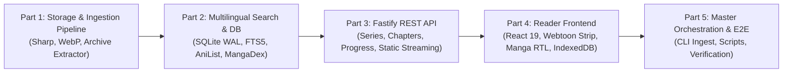

# KuraScroll - Master Architecture & Implementation Roadmap

> **For agentic workers:** REQUIRED SUB-SKILL: Use superpowers:subagent-driven-development or superpowers:executing-plans to implement this plan task-by-task.

- **System:** KuraScroll (Proyecto Hermano de KuraStream)
- **Target Hardware:** Windows Local Environment + 4TB HDD External/Internal Storage
- **Design Spec:** [`docs/superpowers/specs/2026-11-01-kura-scroll-design.md`](file:///C:/Users/Admin/dev/kura-scroll/docs/superpowers/specs/2026-11-01-kura-scroll-design.md)
- **Status:** Plans Structured & Ready for Execution

---

## 1. Executive Summary & Brand Identity

**KuraScroll** is the companion platform to Carlos's **KuraStream**. It extends the ecosystem to Manga, Manhwa, and Manhua while keeping the iconic **KS** monogram logo intact.

### Key Architectural Decisions:
1. **Mechanical 4TB HDD Storage Strategy:** Raw high-res scanlation chapters (100MB+) are passed through an automated Sharp pipeline (WebP q=82, max width 1440px). This reduces chapter sizes by ~85% (down to 12-18MB), expanding the 4TB drive capacity to over **200,000 chapters**. Aggressive HTTP `Cache-Control: immutable` headers eliminate mechanical HDD seek bottlenecks once loaded into the browser.
2. **Instant Multilingual Search:** Fans search by Japanese Romaji (*Kimetsu no Yaiba*), English (*Demon Slayer*), Spanish (*Guardianes de la Noche*), or Kanji (*鬼滅の刃*). SQLite FTS5 indexes all aliases and synonyms collected via MangaDex API v5 and AniList GraphQL, guaranteeing single-record resolution.
3. **Dual-Engine Reader (Zero Layout Shift):**
   - **Webtoon Mode:** Infinite vertical strip with virtualized windowing, so 100+ page manhwa chapters do not crash mobile or low-RAM devices.
   - **Manga Mode:** Paginated Right-to-Left (RTL) / Left-to-Right (LTR) reading with keyboard (`←`, `→`, `A`, `D`) and tap navigation.
   - Pre-computed `aspectRatio` container attributes prevent cumulative layout shift (CLS).
4. **Offline-First Guest Reading:** Browsing history, last-read page, and bookmarks persist directly in browser `IndexedDB` with automatic cloud synchronization to the backend.

---

## 2. Implementation Modules Breakdown (Scrum Sprints)



### Modular Implementation Plans:

1. **[Part 1: Storage & Ingestion Pipeline](file:///C:/Users/Admin/dev/kura-scroll/docs/superpowers/plans/2026-11-01-part1-storage-ingestion.md)**
   - Task 1: Project Initialization & Ingestion Engine Scaffolding
   - Task 2: Natural Sorter & Archive Extractor with Zip Slip Protection
   - Task 3: Image Optimizer & WebP Pipeline via Sharp
   - Task 4: Chapter Ingestion Coordinator & Manifest Builder

2. **[Part 2: Multilingual Metadata & Search Subsystem](file:///C:/Users/Admin/dev/kura-scroll/docs/superpowers/plans/2026-11-01-part2-metadata-search.md)**
   - Task 1: SQLite Connection & Migration Engine (WAL mode, FTS5)
   - Task 2: Multilingual Search Repository (`series_search_fts`)
   - Task 3: MangaDex API v5 Client (`altTitles` & covers)
   - Task 4: AniList GraphQL Client & Metadata Resolver

3. **[Part 3: Backend REST API & Chapter Delivery](file:///C:/Users/Admin/dev/kura-scroll/docs/superpowers/plans/2026-11-01-part3-backend-api.md)**
   - Task 1: Fastify Server Setup & Static Storage Streaming
   - Task 2: Series & Catalog API Routes
   - Task 3: Chapter Manifest & Navigation Routes
   - Task 4: Reading Progress Synchronization Routes

4. **[Part 4: Reader UI & Dual-Engine Frontend](file:///C:/Users/Admin/dev/kura-scroll/docs/superpowers/plans/2026-11-01-part4-reader-frontend.md)**
   - Task 1: Frontend App Scaffolding & Design System (KS Monogram)
   - Task 2: Multilingual Search & Catalog Grid
   - Task 3: Dual-Engine Reader Component (Webtoon + Manga RTL/LTR)
   - Task 4: Client-Side IndexedDB Storage & Progress Sync

5. **[Part 5: Master Orchestration & Integration](file:///C:/Users/Admin/dev/kura-scroll/docs/superpowers/plans/2026-11-01-part5-master-orchestration.md)**
   - Task 1: Root Workspace Orchestration & Environment Configuration
   - Task 2: CLI Ingestion Tool for 4TB Hard Drive Operations
   - Task 3: Full End-to-End Pipeline Verification

---

## 3. Directory Structure Summary

```text
C:\Users\Admin\dev\kura-scroll\
├── docs\
│   └── superpowers\
│       ├── specs\
│       │   └── 2026-11-01-kura-scroll-design.md
│       ├── plans\
│       │   ├── 2026-11-01-kura-scroll-master-plan.md
│       │   ├── 2026-11-01-part1-storage-ingestion.md
│       │   ├── 2026-11-01-part2-metadata-search.md
│       │   ├── 2026-11-01-part3-backend-api.md
│       │   ├── 2026-11-01-part4-reader-frontend.md
│       │   └── 2026-11-01-part5-master-orchestration.md
│       └── sdd\
│           └── progress.md
├── data\
│   ├── kura-scroll.db
│   └── storage\                        <-- 4TB HDD destination
│       ├── covers\
│       └── series\
├── src\backend\
└── frontend\
```
