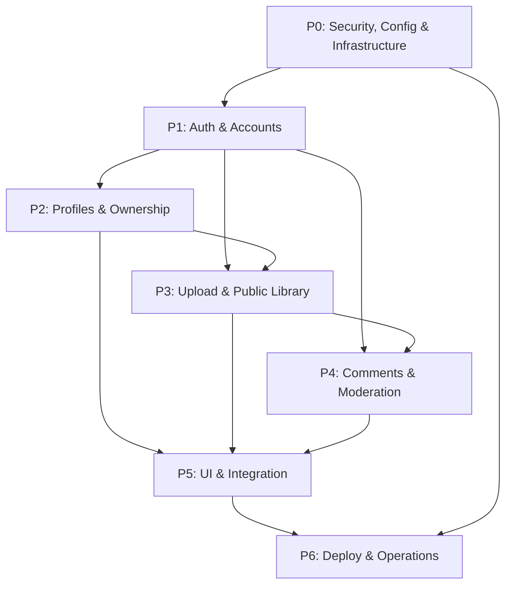

# KuraScroll Cloud-Community Platform — Master Implementation Plan

> **Date:** 2026-11-05  
> **Objective:** Convert KuraScroll from a local/self-hosted single-user manga reader into a cloud-deployable multi-user community platform with authentication, user-published content, public catalog, comments, and moderation — while preserving full backward-compatibility with local/self-hosted installations.

---

## 1. Current State Analysis

### 1.1 Existing Architecture (Verified from Code)

| Layer | Technology | Key Files |
|-------|-----------|-----------|
| Backend | Fastify 5 + TypeScript | `src/backend/app.ts`, `src/backend/server.ts` |
| Database | SQLite via `node:sqlite` (DatabaseSync, synchronous API) | `src/backend/db/database.ts`, `src/backend/db/schema.sql` (2172 lines, ~120+ tables) |
| Frontend | React 19 + Vite + Tailwind CSS 4 | `frontend/src/App.tsx` (state-based routing, no React Router) |
| Storage | Local filesystem, images processed with Sharp | `src/backend/config/storage-config.ts` |
| Auth | **NONE** — all `user_id` columns contain hardcoded strings (`'local_user'`, `'default_user'`) | — |
| Sessions | **NONE** | — |
| User Accounts | **NONE** — no users table, no registration, no login | — |
| Comments | **NONE** | — |
| Profiles | **NONE** | — |
| Email/SMTP | **NONE** | — |
| Docker | **NONE** — no Dockerfile, docker-compose, or .dockerignore | — |
| CORS | Configurable via `KURA_CORS_ORIGINS` env, defaults to `localhost:5173` | `src/backend/app.ts` L339-351 |
| API Token | Optional `API_TOKEN` env, required when `HOST !== loopback` | `src/backend/server.ts` L15-17, `src/backend/app.ts` L355-368 |

### 1.2 Key Observations

- **Massive reader feature set:** 120+ database tables, 100+ route files, 100+ service files — all reader/visual/audio HUD features.
- **No user management whatsoever:** Series, chapters, and all content is ingested via CLI (`ingest-cli.ts`) or folder watcher — there is no web-based upload flow.
- **Schema uses `CREATE TABLE IF NOT EXISTS`:** Safe to append new tables without breaking existing ones.
- **The `app.ts` file is 786 lines** with ~100 route registrations. New routes must be added there.
- **Frontend uses state-based routing** (no React Router) — navigation via `setView()` and URL search params.
- **Existing API token mechanism** provides per-deployment protection but is **not user-level auth**.

### 1.3 SQLite Multi-User Compatibility

> [!IMPORTANT]
> SQLite with WAL mode supports concurrent reads and serialized writes. Capacity has not been benchmarked for this application, so no concurrent-user figure is promised. Keep one server process/container with persistent storage; do not share the database file between replicas or use ephemeral storage.

**Decision:** Keep SQLite for this phase. Document PostgreSQL + object storage migration as a future phase. Use persistent volume for Docker deployments.

---

## 2. Architecture Decisions & Assumptions

| Decision | Rationale |
|----------|-----------|
| **Password + optional email verification** (not passwordless-only) | More conventional UX for a manga community; email verification is optional per deployment |
| **bcrypt-equivalent via scrypt** (Node.js built-in `crypto.scryptSync`) | No external dependency; scrypt is OWASP-recommended, available natively in Node.js |
| **Session cookies (HttpOnly, Secure, SameSite=Lax)** | Standard secure session management; no JWT in localStorage |
| **Session table in SQLite** with expiry/revocation | Simple, queryable, garbage-collectable |
| **CSRF protection via SameSite=Lax + custom header check** | For state-changing requests, require `X-Requested-With` header (SPA always sends it) |
| **Roles: `user`, `moderator`, `admin`** | Minimum viable role model |
| **Series ownership via `uploader_user_id` column** | Added to existing `series` table; NULL for legacy CLI-ingested content (admin-owned) |
| **Content states: `draft`, `published`, `under_review`, `removed`** | Added `visibility` column to `series` and `chapters` tables |
| **Comment scopes: series-level and chapter-level** | Separate `target_type` field in comments table |
| **SMTP via Nodemailer** | Standard, configurable via ENV; optional — can run without email |
| **File uploads via multipart/form-data** | Using `@fastify/multipart`; validate MIME, size, magic bytes |
| **Docker: multi-stage build** | Build frontend + compile backend in builder stage; run in slim Node.js image |
| **Single-container deployment** | SQLite + local files require single-process; document this limitation |

---

## 3. Dependency Map



---

## 4. Phase Breakdown

### P0: Security, Configuration & Infrastructure

**Objective:** Establish secure configuration, environment management, rate limiting, CSRF protection, and Docker build infrastructure.

#### Tasks

| # | Task | Files |
|---|------|-------|
| P0.1 | Extend `.env.example` with all new environment variables (SESSION_SECRET, SMTP_*, UPLOAD_MAX_SIZE, REQUIRE_EMAIL_VERIFICATION, etc.) | `.env.example` |
| P0.2 | Create `src/backend/config/app-config.ts` — centralized typed config from ENV with defaults and validation | `src/backend/config/app-config.ts` |
| P0.3 | Add `@fastify/rate-limit` dependency and configure global + per-route rate limiting | `package.json`, `src/backend/app.ts` |
| P0.4 | Add `@fastify/cookie` dependency for session cookie management | `package.json`, `src/backend/app.ts` |
| P0.5 | Add `@fastify/multipart` dependency for file uploads | `package.json` |
| P0.6 | Implement CSRF protection middleware (SameSite=Lax + `X-Requested-With` header check on mutations) | `src/backend/middleware/csrf-guard.ts` |
| P0.7 | Create `Dockerfile` (multi-stage: build frontend + tsc backend → slim runtime with non-root user, healthcheck) | `Dockerfile` |
| P0.8 | Create `docker-compose.yml` with persistent volume, env_file, health check, port mapping | `docker-compose.yml` |
| P0.9 | Create `.dockerignore` | `.dockerignore` |
| P0.10 | Create `DEPLOY.md` — deployment guide with Docker, VPS, env var reference, backup/restore, limitations | `DEPLOY.md` |

#### Schema Changes

None in P0.

#### API Contracts

None in P0 (infrastructure only).

#### Acceptance Criteria

- [ ] All new ENV vars documented in `.env.example` with explanatory comments
- [ ] Rate limiting active on all routes (configurable burst/window)
- [ ] CSRF guard rejects mutation requests without `X-Requested-With` header (except API token auth)
- [ ] Docker build produces a working image that serves both backend and frontend
- [ ] Docker Compose starts a container with persistent data volume
- [ ] Non-root user in container; healthcheck returns 200 on `/health`

---

### P1: Authentication & Accounts

**Objective:** User registration, login, session management, optional email verification, and auth middleware.

#### Tasks

| # | Task | Files |
|---|------|-------|
| P1.1 | Add `users` table to schema (id, handle, email, display_name, password_hash, role, email_verified, avatar_url, bio, created_at, updated_at) | `src/backend/db/schema.sql` |
| P1.2 | Add `sessions` table (id/token_hash, user_id, expires_at, created_at, ip_address, user_agent) | `src/backend/db/schema.sql` |
| P1.3 | Add `email_verification_codes` table (user_id, code_hash, expires_at, used, attempts, created_at) | `src/backend/db/schema.sql` |
| P1.4 | Create `src/backend/repositories/user-repository.ts` — CRUD for users, find by handle/email, password verification | `src/backend/repositories/user-repository.ts` |
| P1.5 | Create `src/backend/repositories/session-repository.ts` — create/validate/revoke sessions, garbage collection | `src/backend/repositories/session-repository.ts` |
| P1.6 | Create `src/backend/services/auth-service.ts` — password hashing (scrypt), session creation, email verification flow | `src/backend/services/auth-service.ts` |
| P1.7 | Create `src/backend/services/email-service.ts` — SMTP email sending via Nodemailer (optional, configurable) | `src/backend/services/email-service.ts` |
| P1.8 | Create `src/backend/middleware/auth-middleware.ts` — Fastify hook to extract session from cookie, attach `request.user`; `requireAuth` and `requireRole` decorators | `src/backend/middleware/auth-middleware.ts` |
| P1.9 | Create `src/backend/routes/auth-routes.ts` — POST `/api/v1/auth/register`, `/api/v1/auth/login`, `/api/v1/auth/logout`, `/api/v1/auth/verify-email`, GET `/api/v1/auth/me` | `src/backend/routes/auth-routes.ts` |
| P1.10 | Register auth routes and middleware in `app.ts` | `src/backend/app.ts` |

#### Schema (appended to schema.sql)

```sql
CREATE TABLE IF NOT EXISTS users (
    id TEXT PRIMARY KEY,
    handle TEXT UNIQUE NOT NULL CHECK(length(handle) BETWEEN 3 AND 30),
    email TEXT UNIQUE NOT NULL,
    display_name TEXT NOT NULL CHECK(length(display_name) BETWEEN 1 AND 60),
    password_hash TEXT NOT NULL,
    role TEXT NOT NULL DEFAULT 'user' CHECK(role IN ('user', 'moderator', 'admin')),
    email_verified INTEGER NOT NULL DEFAULT 0,
    avatar_url TEXT,
    bio TEXT CHECK(bio IS NULL OR length(bio) <= 500),
    created_at TEXT DEFAULT (datetime('now')),
    updated_at TEXT DEFAULT (datetime('now'))
);

CREATE TABLE IF NOT EXISTS sessions (
    id TEXT PRIMARY KEY,
    token_hash TEXT UNIQUE NOT NULL,
    user_id TEXT NOT NULL REFERENCES users(id) ON DELETE CASCADE,
    expires_at TEXT NOT NULL,
    ip_address TEXT,
    user_agent TEXT,
    created_at TEXT DEFAULT (datetime('now'))
);

CREATE TABLE IF NOT EXISTS email_verification_codes (
    id INTEGER PRIMARY KEY AUTOINCREMENT,
    user_id TEXT NOT NULL REFERENCES users(id) ON DELETE CASCADE,
    code_hash TEXT NOT NULL,
    expires_at TEXT NOT NULL,
    used INTEGER NOT NULL DEFAULT 0,
    attempts INTEGER NOT NULL DEFAULT 0,
    created_at TEXT DEFAULT (datetime('now'))
);
```

#### API Contracts

| Method | Path | Auth | Body | Response |
|--------|------|------|------|----------|
| POST | `/api/v1/auth/register` | None | `{ handle, email, password, displayName }` | `201 { user: { id, handle, displayName } }` |
| POST | `/api/v1/auth/login` | None | `{ login, password }` (login = handle or email) | `200 { user }` + Set-Cookie |
| POST | `/api/v1/auth/logout` | Required | — | `200 { ok: true }` |
| GET | `/api/v1/auth/me` | Required | — | `200 { user }` |
| POST | `/api/v1/auth/verify-email` | Required | `{ code }` | `200 { verified: true }` |
| POST | `/api/v1/auth/resend-verification` | Required | — | `200 { sent: true }` |

#### Acceptance Criteria

- [ ] Registration validates handle format (alphanumeric + underscores, 3-30 chars), email format, password strength (min 8 chars)
- [ ] Passwords stored as scrypt hashes with random salt
- [ ] Session token is a crypto-random 32-byte hex string; only hash stored in DB
- [ ] Session cookie: `HttpOnly`, `Secure` in production (configurable), `SameSite=Lax`, path `/`, max-age 30 days
- [ ] Login rate limited: 5 attempts per handle per 15 minutes
- [ ] Email verification code: 6 digits, 15 min expiry, max 3 attempts, single use, hash stored
- [ ] SMTP failures do not crash the server or block registration
- [ ] `GET /api/v1/auth/me` never returns email or password_hash in response
- [ ] Existing routes continue to work for unauthenticated users (backward compatible)

#### Risks

- Node.js `node:sqlite` DatabaseSync is synchronous — scrypt hashing should use the sync variant to avoid blocking the event loop in a way that conflicts with the sync DB pattern. This is acceptable for moderate traffic.

---

### P2: Profiles & Ownership/Privacy

**Objective:** Public user profiles, series ownership, and draft/published visibility states.

#### Tasks

| # | Task | Files |
|---|------|-------|
| P2.1 | Create `src/backend/routes/profile-routes.ts` — GET `/api/v1/users/:handle` (public profile), PUT `/api/v1/users/me` (update own profile) | `src/backend/routes/profile-routes.ts` |
| P2.2 | Add `uploader_user_id` and `visibility` columns to `series` table (nullable FK, default 'published' for backward compat) | `src/backend/db/schema.sql` |
| P2.3 | Add `visibility` column to `chapters` table | `src/backend/db/schema.sql` |
| P2.4 | Update `series-routes.ts` to filter by visibility='published' for public listing; allow owner/admin to see own drafts | `src/backend/routes/series-routes.ts` |
| P2.5 | Create authorization helper: `canEditSeries(userId, seriesId)` → owner or admin | `src/backend/services/auth-service.ts` |
| P2.6 | Frontend: Create profile page/modal component | `frontend/src/pages/ProfilePage.tsx` |

#### API Contracts

| Method | Path | Auth | Response |
|--------|------|------|----------|
| GET | `/api/v1/users/:handle` | None | `{ handle, displayName, avatarUrl, bio, createdAt, seriesCount }` |
| PUT | `/api/v1/users/me` | Required | `{ user }` |
| PUT | `/api/v1/users/me/avatar` | Required | multipart upload → `{ avatarUrl }` |

#### Schema Changes

```sql
-- Added to series table via ALTER or new column defaults
-- uploader_user_id TEXT REFERENCES users(id) ON DELETE SET NULL
-- visibility TEXT NOT NULL DEFAULT 'published' CHECK(visibility IN ('draft','published','under_review','removed'))
```

#### Acceptance Criteria

- [ ] Public profiles show handle, display name, avatar, bio, joined date, public series count
- [ ] Email never exposed in public profile
- [ ] Users can edit only their own profile
- [ ] Draft series only visible to owner and admins
- [ ] Legacy series (no uploader_user_id) remain visible and editable by admins only

---

### P3: Upload & Public Library

**Objective:** Web-based manga/chapter upload, cover images, page file validation, and public searchable catalog.

#### Tasks

| # | Task | Files |
|---|------|-------|
| P3.1 | Create `src/backend/routes/upload-routes.ts` — POST series creation, chapter upload with multipart pages | `src/backend/routes/upload-routes.ts` |
| P3.2 | Create `src/backend/services/upload-service.ts` — file validation (MIME check via magic bytes, size limits, ZIP/CBZ path traversal protection), storage management | `src/backend/services/upload-service.ts` |
| P3.3 | Add `@fastify/multipart` registration in app.ts | `src/backend/app.ts` |
| P3.4 | Update series-routes to support visibility filtering in public catalog | `src/backend/routes/series-routes.ts` |
| P3.5 | Create `src/backend/routes/manage-series-routes.ts` — PUT/DELETE for series and chapters (owner/admin only) | `src/backend/routes/manage-series-routes.ts` |
| P3.6 | Frontend: Create upload page/flow components | `frontend/src/pages/UploadPage.tsx`, `frontend/src/components/upload/` |

#### API Contracts

| Method | Path | Auth | Purpose |
|--------|------|------|---------|
| POST | `/api/v1/manga` | Required | Create new manga series |
| PUT | `/api/v1/manga/:seriesId` | Owner/Admin | Update manga metadata |
| DELETE | `/api/v1/manga/:seriesId` | Owner/Admin | Remove manga (soft delete → visibility='removed') |
| POST | `/api/v1/manga/:seriesId/chapters` | Owner/Admin | Upload chapter with pages |
| PUT | `/api/v1/manga/:seriesId/chapters/:chapterId` | Owner/Admin | Update chapter |
| DELETE | `/api/v1/manga/:seriesId/chapters/:chapterId` | Owner/Admin | Remove chapter |
| POST | `/api/v1/manga/:seriesId/cover` | Owner/Admin | Upload cover image |

#### Acceptance Criteria

- [ ] Uploaded images validated: magic bytes check for JPEG/PNG/WebP/GIF, max 20MB per image, max 200 pages per chapter
- [ ] ZIP/CBZ uploads: path traversal protection, zip bomb detection (ratio check), extraction to temp dir
- [ ] Stored files go to `STORAGE_ROOT/series/<seriesId>/chapters/<chapterId>/`
- [ ] Cover images stored at `STORAGE_ROOT/covers/<seriesId>.webp`
- [ ] Images processed through existing Sharp pipeline (WebP q=82, max width 1440px)
- [ ] Upload rate limited: 5 chapters per hour per user
- [ ] Series slug auto-generated from title, checked for uniqueness

---

### P4: Comments & Moderation

**Objective:** Comments on series and chapters, content reporting, and moderation tools.

#### Tasks

| # | Task | Files |
|---|------|-------|
| P4.1 | Add `comments` table to schema | `src/backend/db/schema.sql` |
| P4.2 | Add `content_reports` table | `src/backend/db/schema.sql` |
| P4.3 | Create `src/backend/repositories/comment-repository.ts` | `src/backend/repositories/comment-repository.ts` |
| P4.4 | Create `src/backend/routes/comment-routes.ts` | `src/backend/routes/comment-routes.ts` |
| P4.5 | Create `src/backend/routes/moderation-routes.ts` — report content, list reports (moderator), resolve reports, ban users | `src/backend/routes/moderation-routes.ts` |
| P4.6 | Frontend: Comment components for series detail and chapter pages | `frontend/src/components/comments/` |
| P4.7 | Frontend: Report button and moderation panel (admin/moderator) | `frontend/src/components/moderation/` |

#### Schema

```sql
CREATE TABLE IF NOT EXISTS comments (
    id TEXT PRIMARY KEY,
    user_id TEXT NOT NULL REFERENCES users(id) ON DELETE CASCADE,
    target_type TEXT NOT NULL CHECK(target_type IN ('series', 'chapter')),
    target_id TEXT NOT NULL,
    parent_id TEXT REFERENCES comments(id) ON DELETE CASCADE,
    body TEXT NOT NULL CHECK(length(body) BETWEEN 1 AND 2000),
    is_edited INTEGER NOT NULL DEFAULT 0,
    is_deleted INTEGER NOT NULL DEFAULT 0,
    created_at TEXT DEFAULT (datetime('now')),
    updated_at TEXT DEFAULT (datetime('now'))
);

CREATE TABLE IF NOT EXISTS content_reports (
    id TEXT PRIMARY KEY,
    reporter_user_id TEXT NOT NULL REFERENCES users(id) ON DELETE CASCADE,
    target_type TEXT NOT NULL CHECK(target_type IN ('series', 'chapter', 'comment', 'user')),
    target_id TEXT NOT NULL,
    reason TEXT NOT NULL CHECK(reason IN ('spam', 'harassment', 'copyright', 'inappropriate', 'other')),
    description TEXT CHECK(description IS NULL OR length(description) <= 1000),
    status TEXT NOT NULL DEFAULT 'pending' CHECK(status IN ('pending', 'reviewed', 'resolved', 'dismissed')),
    resolved_by TEXT REFERENCES users(id),
    resolved_at TEXT,
    created_at TEXT DEFAULT (datetime('now'))
);
```

#### API Contracts

| Method | Path | Auth | Purpose |
|--------|------|------|---------|
| GET | `/api/v1/comments?target_type=series&target_id=X&page=1` | None | List comments |
| POST | `/api/v1/comments` | Required | Create comment |
| PUT | `/api/v1/comments/:id` | Author | Edit comment |
| DELETE | `/api/v1/comments/:id` | Author/Mod/Admin | Delete comment |
| POST | `/api/v1/reports` | Required | Report content |
| GET | `/api/v1/admin/reports` | Mod/Admin | List reports |
| PUT | `/api/v1/admin/reports/:id` | Mod/Admin | Resolve report |

#### Acceptance Criteria

- [ ] Comments support replies (parent_id), max depth 1 (flat threads)
- [ ] Comment body HTML-escaped before storage, max 2000 chars
- [ ] Deleted comments show "Comentario eliminado" placeholder
- [ ] Rate limit: 10 comments per minute per user
- [ ] Report reasons are enumerated; duplicate reports from same user rejected
- [ ] Moderator panel lists unresolved reports with target context

---

### P5: UI & Integration

**Objective:** Frontend pages for login/register, profile, upload, comments, and navigation integration.

#### Tasks

| # | Task | Files |
|---|------|-------|
| P5.1 | Create auth context/hook `useAuth` for frontend state management | `frontend/src/hooks/useAuth.ts` |
| P5.2 | Create Login/Register pages | `frontend/src/pages/LoginPage.tsx`, `frontend/src/pages/RegisterPage.tsx` |
| P5.3 | Update `App.tsx` to add new views and conditional rendering based on auth state | `frontend/src/App.tsx` |
| P5.4 | Create API client helper for authenticated requests | `frontend/src/api/client.ts` |
| P5.5 | Integrate comment section into SeriesDetailPage | `frontend/src/pages/SeriesDetailPage.tsx` |
| P5.6 | Create user menu in Navbar area (without modifying Navbar.tsx — use a sibling component) | `frontend/src/components/common/UserMenu.tsx` |

#### Acceptance Criteria

- [ ] Login/register forms with validation and error display
- [ ] Auth state persists across page reloads (checked via `GET /api/v1/auth/me`)
- [ ] Logout clears session cookie and local state
- [ ] Upload page accessible only to authenticated users
- [ ] Comments display author handle, avatar, relative timestamp
- [ ] Loading, error, and empty states for all new views

---

### P6: Deployment, Migration & Operations

**Objective:** Docker deployment, operational documentation, backup/restore, and monitoring.

#### Tasks

| # | Task | Files |
|---|------|-------|
| P6.1 | Finalize Dockerfile with production optimizations | `Dockerfile` |
| P6.2 | Create `docker-compose.yml` with complete config | `docker-compose.yml` |
| P6.3 | Update DEPLOY.md with complete deployment guide | `DEPLOY.md` |
| P6.4 | Document backup/restore procedures for SQLite DB and storage volume | `DEPLOY.md` |
| P6.5 | Document rate limits, storage quotas, SMTP setup, moderator setup | `DEPLOY.md` |
| P6.6 | Add session garbage collection to maintenance daemon | `src/backend/daemon/maintenance-daemon.ts` |

#### Acceptance Criteria

- [ ] `docker build .` produces a working image
- [ ] `docker compose up` starts the full stack with persistent volume
- [ ] Health endpoint returns DB status, storage status, uptime
- [ ] DEPLOY.md covers: environment variables, Docker, VPS, backups, SMTP, first admin creation, rate limits, storage limits, copyright policy
- [ ] Document limitation: single-container only, no horizontal scaling with SQLite
- [ ] Document future migration path: PostgreSQL + S3-compatible object storage

---

## 5. Subagent Work Division

| Agent | Phases | Owned Files | Dependencies |
|-------|--------|-------------|--------------|
| **Agent 1: Auth Backend** | P0 (partial), P1 | `config/app-config.ts`, `middleware/`, `repositories/user-repository.ts`, `repositories/session-repository.ts`, `services/auth-service.ts`, `services/email-service.ts`, `routes/auth-routes.ts`, schema additions | None |
| **Agent 2: Profiles & Ownership** | P2 | `routes/profile-routes.ts`, series table modifications, visibility filtering in `series-routes.ts` | Agent 1 (users table + auth middleware) |
| **Agent 3: Upload & Content Management** | P3 | `routes/upload-routes.ts`, `routes/manage-series-routes.ts`, `services/upload-service.ts` | Agent 1 (auth), Agent 2 (ownership) |
| **Agent 4: Comments & Moderation** | P4 | `repositories/comment-repository.ts`, `routes/comment-routes.ts`, `routes/moderation-routes.ts`, schema additions | Agent 1 (auth) |
| **Agent 5: Frontend Auth & UI** | P5 | `frontend/src/hooks/useAuth.ts`, `frontend/src/pages/LoginPage.tsx`, `frontend/src/pages/RegisterPage.tsx`, `frontend/src/pages/ProfilePage.tsx`, `frontend/src/components/common/UserMenu.tsx`, `frontend/src/api/client.ts`, `frontend/src/App.tsx` modifications | Agent 1 (API contracts) |
| **Agent 6: Deployment & Security Review** | P0 (Docker), P6 | `Dockerfile`, `docker-compose.yml`, `.dockerignore`, `DEPLOY.md`, `.env.example`, review proxy, secrets, cookies, uploads, static assets and backups | All agents (final integration) |
| **Main Agent (Orchestrator)** | Integration | `src/backend/app.ts` (route registration), schema integration, final integration and security review | All agents |

### Delegation / Concurrency Rules

- The orchestrator may launch at most **six subagents total**. The six workstreams above are the complete delegation pool; do not spawn additional agents beneath them.
- Start independent workstreams in parallel only after file ownership and API contracts are agreed. Auth and schema contracts must land before dependent profile, upload, comments, and UI integration work.
- Assign each agent exclusive ownership of its listed files. The orchestrator owns cross-cutting files and resolves integration conflicts after agents finish.
- Each agent reports changed files, decisions, unresolved risks, and validation performed. The orchestrator reviews security-sensitive diffs and records validation not run before delivery.

---

## 6. Recommended Tests & Validation Commands (NOT to execute now)

```bash
# Backend unit tests (future)
npx vitest run src/backend/repositories/user-repository.test.ts
npx vitest run src/backend/services/auth-service.test.ts
npx vitest run src/backend/routes/auth-routes.test.ts
npx vitest run src/backend/routes/comment-routes.test.ts
npx vitest run src/backend/services/upload-service.test.ts

# Frontend tests (future)
cd frontend && npx vitest run src/tests/LoginPage.test.tsx
cd frontend && npx vitest run src/tests/useAuth.test.ts

# Docker build verification
docker build -t kura-scroll:test .
docker compose up -d
curl http://localhost:4000/health

# Security checks (future)
# - Verify session cookie flags in browser DevTools
# - Test CSRF: attempt POST without X-Requested-With header
# - Test rate limiting: send 10+ login attempts rapidly
# - Test upload: attempt path traversal in ZIP entries
# - Test SQL injection in comment body / search queries
# - Verify password hash is never returned in any API response
# - Verify email is never exposed in public profile endpoints

# Manual integration tests (future)
# 1. Register user → verify email → login → create series → upload chapter → add comment → logout
# 2. Register second user → verify can see public series → cannot edit other's series → can comment
# 3. Promote user to moderator → verify can delete comments → can resolve reports
# 4. Test offline/legacy mode: start server without SMTP config → registration works without verification
```

---

## 7. Operational Considerations

### 7.1 Email (Optional)

- SMTP configurable via `SMTP_HOST`, `SMTP_PORT`, `SMTP_USER`, `SMTP_PASS`, `SMTP_FROM`
- When SMTP is not configured, email verification is disabled; users are auto-verified
- When `REQUIRE_EMAIL_VERIFICATION=true`, unverified users cannot upload content but can browse and comment

### 7.2 Backups & Restore

- SQLite DB file: `data/kura-scroll.db` — copy while server is stopped, or use `.backup` API
- Storage volume: `data/storage/` — standard filesystem backup (rsync, tar)
- Docker: volume backup via `docker cp` or volume driver snapshots

### 7.3 Storage Limits

- Per-user upload quota: configurable via `USER_UPLOAD_QUOTA_GB` (default: 5 GB)
- Per-image max size: 20 MB
- Per-chapter max pages: 200
- Global storage monitoring via existing telemetry routes

### 7.4 Moderation & Copyright

> [!WARNING]
> KuraScroll does NOT automatically verify copyright ownership of uploaded content. Operators MUST:
> - Establish and publish a DMCA/copyright takedown policy
> - Designate a moderator to handle reports
> - Consider requiring email verification before upload privileges
> - Monitor `content_reports` table for copyright complaints
> - This software provides tools for moderation, NOT legal compliance — operators bear full responsibility

### 7.5 First Admin Setup

- First registered user can be promoted to admin via CLI:
  ```bash
  # Future CLI command (to be implemented)
  npx tsx scripts/promote-admin.ts --handle=<handle>
  ```
- Or directly in SQLite: `UPDATE users SET role = 'admin' WHERE handle = '<handle>';`

### 7.6 Scaling Limitations

> [!IMPORTANT]
> **Current architecture supports: single container/process deployment only.**
> - SQLite does not support concurrent write access from multiple processes
> - File storage is local — not compatible with ephemeral containers or multi-node deployments
> - **Future migration path:** PostgreSQL (drop-in via Kysely/Drizzle migration) + S3-compatible object storage (MinIO/Cloudflare R2)
> - Estimated effort: 2-3 sprints for data layer abstraction

---

## 8. Implementation Outcome and Remaining Deployment Work

| Phase | Delivery state | Scope delivered / remaining |
|------|----------------|-----------------------------|
| P0 — configuration and deployment | Prepared; target infrastructure not provisioned | Docker image and Compose files, production secret checks, cookie/proxy settings, persistent volume, Caddy v2.10.0+ reverse proxy notes, SQLite `julianday` expiry validation, and deployment guide. Configure domain, HTTPS proxy, real SMTP and production secrets on the selected host. |
| P1 — accounts and sessions | Implemented; backend typecheck passed locally | Registration, login/logout, verification codes, optional SMTP verification, session cookies, profiles, exact GET allowlists, authenticated bookmarks/cadence scoping, and rate limits. Production SMTP delivery and account flows still need deployment-level verification. |
| P2 — profiles and ownership | Implemented in repository | Public profiles, user avatar upload (`POST /api/v1/users/me/avatar`), upload ownership, draft preview permissions for series owners/moderators, and visibility controls. |
| P3 — publishing and library | Implemented for series and chapter publishing | Create manga with initial chapter or draft; fail-fast cover image upload (`POST /api/v1/manga/:seriesId/cover`) with atomic draft rollback; subsequent chapter uploads from series page; CBZ/ZIP ingestion with Zip Slip defenses, natural sorting, one archive extraction at a time, a two-request upload cap, Sharp concurrency/cache bounds and quota controls. Archives remain limited to 250 MB compressed and 1 GB extracted; `AdmZip` still loads the compressed archive in memory, so monitor RAM/disk on 2 GB VPS hosts. Server-side paginated catalog (`GET /api/v1/series`). |
| P4 — comments and moderation | Implemented in repository | Independent series/chapter comments, pagination support (`page`, `limit`), 2,000-character upper bounds on creation/editing with rate limiting (`commentRateLimiter`), reporting modal (`POST /api/v1/reports`) with guest auth redirect, moderation panel and endpoints. Public reads restricted to published targets. |
| P5 — frontend integration | Implemented; frontend production build passed locally | Login, registration, account HUD, return-to-originating-view navigation preserving active reader/detail view after authentication, profile with avatar editor, publishing UI with cover error surfacing, chapter uploader with dual page/archive mode, paginated catalog and comment UI, account-scoped reading history (`/api/v1/progress/recent`) isolated from shared browser IndexedDB records. |
| P6 — operations | Prepared | Deployment, backup/restore, SMTP, storage limits, and single-container constraints documented in DEPLOY.md. Automated backup schedule and restore testing pending target host. |

No cloud provider, domain, SMTP account or deployment credentials were supplied, so this work prepares a containerized deployment and does not claim a live cloud instance has been provisioned. Backend typecheck and frontend production build passed locally, and the production dependency audit reported no vulnerabilities. Test suites were not run; Docker Compose validation and image build could not be performed because the Docker CLI is unavailable in this environment.

### Required Before Opening Public Registration

1. Provision a persistent-disk VPS or compatible single-container host and set production `SESSION_SECRET`.
2. Configure DNS and HTTPS through a trusted local reverse proxy; keep the container bound to loopback and configure `TRUST_PROXY` for that proxy only.
3. Set the exact `KURA_CORS_ORIGINS`; provide working SMTP credentials and enable `REQUIRE_EMAIL_VERIFICATION` if email verification is desired.
4. Establish the operator's copyright/takedown policy and designate a moderator before accepting community uploads.
5. Build and start the container on the target host, complete the registration → verification/login → upload → reader comments flow, and verify backup restoration before public launch.

---

*Plan authored by AGY Orchestrator and reconciled during integration review with the code and checks actually completed.*
