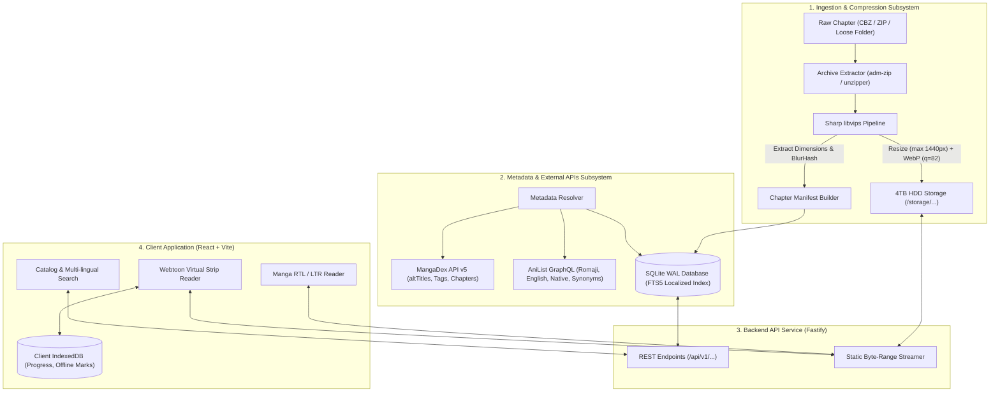

# KuraScroll System Design Specification

- **Project:** KuraScroll (Sister platform to KuraStream)
- **Author / Lead:** Antigravity Architect
- **Owner:** Carlos
- **Date:** 2026-11-01
- **Status:** Approved / In Execution

---

## 1. Intent and The Why

Carlos is developing **KuraStream**, a local-first streaming platform for anime and movies branded with a distinctive "KS" monogram logo. Expanding into graphic literature (Manga, Korean Manhwa, and Chinese Manhua) presents distinct architectural challenges:
1. Graphic reading requires continuous vertical strip streaming (webtoons) or paginated right-to-left flipping (traditional manga) rather than video HLS streaming.
2. File volume is high: raw scanlation releases often come in uncompressed PNG/JPEG archives ranging from 80MB to 180MB per chapter. On a standard 4TB mechanical hard drive, uncompressed raw images would exhaust capacity in under ~30,000 chapters.
3. Manga discovery is hindered by multi-lingual naming barriers: fans search interchangeably by Japanese Romaji (*Kimetsu no Yaiba*), English (*Demon Slayer*), Spanish (*Guardianes de la Noche*), or native Kanji (*鬼滅の刃*).

**KuraScroll** is designed as a standalone "Proyecto Hermano" (sister platform) that shares brand identity (the "KS" monogram logo and aesthetic synergy with KuraStream), but maintains an independent, high-throughput backend and reading interface tuned for image virtualization, lossless/near-lossless WebP compression, and instant multi-lingual search.

---

## 2. Platform Identity & Branding

- **Brand Name:** **KuraScroll**
- **Acronym:** **KS** (Seamlessly shares the KuraStream "KS" logo iconography while adopting reading/scroll accents).
- **Domain / Namespace Availability:** Verified available without trademark or conflicting web presence.
- **Visual Tone:** Deep Void (`#080c14`), Slate Indigo (`#141c2e`), Vivid Cyber Cyan (`#00e5ff`), and Violet Glow (`#8b5cf6`).

---

## 3. Goals, Non-Goals, and Anti-Goals

### 3.1. Goals
- **Optimal 4TB Storage Footprint:** Ingestion pipeline automatically processes CBZ/ZIP/folders, converts pages to optimized WebP (q=82, max width 1440px), stripping metadata and generating dimension manifests. Chapters shrink to 12-18MB, expanding storage capacity to **over 200,000 chapters** on a 4TB drive.
- **Multilingual Search Resolution:** Querying in Japanese Kanji, Romaji, English, Korean, Chinese, or Spanish returns the exact canonical series record instantly via SQLite FTS5 with trigram tokenization.
- **Dual-Engine Reader:**
  - *Webtoon Mode:* Seamless infinite vertical strip with virtualized windowing to avoid DOM bloat and browser crashes on 100+ page manhwa chapters.
  - *Manga Mode:* True Right-to-Left (RTL) and Left-to-Right (LTR) single/double page layout with keyboard and touch hotkeys.
- **Frictionless Guest-First Experience:** Full reading history, bookmarking, and chapter progress tracking stored in browser `IndexedDB`, with optional backend cloud synchronization.
- **Automated Metadata Scraping:** Direct integration with **MangaDex API v5** and **AniList GraphQL API** to pre-fill synopsis, localized titles, genres, publication status, and high-res cover art.

### 3.2. Non-Goals
- Real-time torrent streaming or decentralized P2P sharing in v1.
- Mandatory user registration or paywalled chapters.
- On-the-fly heavy image transcoding (all optimization is executed ahead-of-time upon ingestion to minimize HDD seek latency).

### 3.3. Anti-Goals
- Storing uncompressed raw PNG/BMP scans that saturate the 4TB disk.
- Layout shifts during reading (every page must load with preserved aspect-ratio dimensions and blurhash placeholders).
- Rigid single-language database schemas that fail when a user types a localized or alternate title.

---

## 4. Architectural Constraints & Hardware Strategy

- **Primary Storage (4TB HDD):** Mechanical HDDs suffer from low random read IOPS (~75-100 IOPS). Serving hundreds of loose 5MB image files concurrently directly from raw disk paths creates head thrashing.
  - *Solution:* WebP batch compression reduces byte size by 85%. Images are stored in hierarchical, hashed subdirectories (`/storage/series/<slug>/v<vol>/c<chap>/<idx>.webp`). Active reader chapters are served with `Cache-Control: public, max-age=31536000, immutable` alongside an in-memory LRU cache for the current chapter's pages.
- **Local Host Runtime:** Windows 10/11 with Node.js v24.19, Python 3.14, SQLite 3.

---

## 5. Technology Stack Selection

| Layer | Selected Tech | Rationale & Trade-offs |
|---|---|---|
| **Backend Runtime** | **Node.js (v24 LTS) + TypeScript** | High concurrency, native async I/O, unified language between frontend and backend. |
| **API Framework** | **Fastify (or Express 5)** | Sub-millisecond routing overhead, native schema validation via TypeBox/Zod, built-in static file streaming. |
| **Image Processing Engine** | **Sharp (libvips C-bindings)** | 4x to 8x faster than Python Pillow or PHP GD. Directly converts CBZ/ZIP/PNG/JPEG to optimized WebP with thread pool parallelism. |
| **Database** | **SQLite with WAL mode + FTS5** | Zero-configuration single file database, ultra-fast reads, full-text search across all language aliases, easily backed up to HDD. |
| **Frontend Framework** | **React 19 + Vite + TypeScript** | Instant HMR, component isolation, rich ecosystem for virtualized lists (`@tanstack/react-virtual`). |
| **Styling & Icons** | **Tailwind CSS v4 + Lucide React** | Rapid styling, zero runtime CSS overhead, accessible icons matching KuraStream. |
| **Client Storage** | **idb (IndexedDB wrapper)** | Offline persistent storage for chapter progress, bookmarks, and last-read page offsets without login. |

---

## 6. Subsystem Architecture



---

## 7. Data Model & Database Schema

The database schema is designed for SQLite with foreign keys enabled:

```sql
-- Series Master Table
CREATE TABLE IF NOT EXISTS series (
    id TEXT PRIMARY KEY,               -- UUIDv4 or slug
    slug TEXT UNIQUE NOT NULL,
    title_primary TEXT NOT NULL,
    type TEXT NOT NULL CHECK(type IN ('manga', 'manhwa', 'manhua', 'comic')),
    status TEXT NOT NULL CHECK(status IN ('ongoing', 'completed', 'hiatus', 'cancelled')),
    demographic TEXT CHECK(demographic IN ('shounen', 'seinen', 'shoujo', 'josei', 'none')),
    synopsis TEXT,
    cover_image TEXT,
    banner_image TEXT,
    author TEXT,
    artist TEXT,
    release_year INTEGER,
    anilist_id INTEGER,
    mangadex_id TEXT,
    created_at DATETIME DEFAULT CURRENT_TIMESTAMP,
    updated_at DATETIME DEFAULT CURRENT_TIMESTAMP
);

-- Multi-lingual Title Aliases for Search
CREATE TABLE IF NOT EXISTS series_titles (
    id INTEGER PRIMARY KEY AUTOINCREMENT,
    series_id TEXT NOT NULL REFERENCES series(id) ON DELETE CASCADE,
    language_code TEXT NOT NULL,       -- 'ja', 'ja-ro', 'en', 'es', 'ko', 'zh', etc.
    title TEXT NOT NULL,
    is_primary BOOLEAN DEFAULT 0
);

-- Full Text Search Index across All Localized Names
CREATE VIRTUAL TABLE IF NOT EXISTS series_search_fts USING fts5(
    series_id UNINDEXED,
    title,
    content='series_titles',
    content_rowid='id'
);

-- Triggers to keep FTS index synchronized
CREATE TRIGGER IF NOT EXISTS series_titles_ai AFTER INSERT ON series_titles BEGIN
    INSERT INTO series_search_fts(rowid, series_id, title) VALUES (new.id, new.series_id, new.title);
END;

CREATE TRIGGER IF NOT EXISTS series_titles_ad AFTER DELETE ON series_titles BEGIN
    INSERT INTO series_search_fts(series_search_fts, rowid, series_id, title) VALUES('delete', old.id, old.series_id, old.title);
END;

-- Genres and Taxonomy
CREATE TABLE IF NOT EXISTS genres (
    id INTEGER PRIMARY KEY AUTOINCREMENT,
    name TEXT UNIQUE NOT NULL,
    slug TEXT UNIQUE NOT NULL
);

CREATE TABLE IF NOT EXISTS series_genres (
    series_id TEXT NOT NULL REFERENCES series(id) ON DELETE CASCADE,
    genre_id INTEGER NOT NULL REFERENCES genres(id) ON DELETE CASCADE,
    PRIMARY KEY (series_id, genre_id)
);

-- Volumes / Seasons
CREATE TABLE IF NOT EXISTS volumes (
    id TEXT PRIMARY KEY,
    series_id TEXT NOT NULL REFERENCES series(id) ON DELETE CASCADE,
    volume_number REAL NOT NULL,        -- Allows float for side stories/specials
    name TEXT,
    created_at DATETIME DEFAULT CURRENT_TIMESTAMP,
    UNIQUE(series_id, volume_number)
);

-- Chapters
CREATE TABLE IF NOT EXISTS chapters (
    id TEXT PRIMARY KEY,
    series_id TEXT NOT NULL REFERENCES series(id) ON DELETE CASCADE,
    volume_id TEXT REFERENCES volumes(id) ON DELETE SET NULL,
    chapter_number REAL NOT NULL,       -- Real number supports 10.5, 0.1, etc.
    title TEXT,
    scanlation_group TEXT,
    page_count INTEGER NOT NULL DEFAULT 0,
    storage_path TEXT NOT NULL,         -- Relative path on 4TB storage
    created_at DATETIME DEFAULT CURRENT_TIMESTAMP,
    UNIQUE(series_id, chapter_number)
);

-- Pages Manifest (Enables Zero Layout Shift)
CREATE TABLE IF NOT EXISTS chapter_pages (
    id INTEGER PRIMARY KEY AUTOINCREMENT,
    chapter_id TEXT NOT NULL REFERENCES chapters(id) ON DELETE CASCADE,
    page_number INTEGER NOT NULL,
    file_name TEXT NOT NULL,            -- e.g. "001.webp"
    width INTEGER NOT NULL,
    height INTEGER NOT NULL,
    aspect_ratio REAL NOT NULL,
    blurhash TEXT,
    UNIQUE(chapter_id, page_number)
);

-- Optional User Session Sync & Bookmarks
CREATE TABLE IF NOT EXISTS user_progress (
    id INTEGER PRIMARY KEY AUTOINCREMENT,
    user_id TEXT DEFAULT 'local_user',
    series_id TEXT NOT NULL REFERENCES series(id) ON DELETE CASCADE,
    chapter_id TEXT NOT NULL REFERENCES chapters(id) ON DELETE CASCADE,
    page_number INTEGER NOT NULL DEFAULT 1,
    scroll_offset_y REAL DEFAULT 0,
    is_completed BOOLEAN DEFAULT 0,
    updated_at DATETIME DEFAULT CURRENT_TIMESTAMP,
    UNIQUE(user_id, series_id)
);
```

---

## 8. Directory Structure on 4TB Disk

```text
C:\Users\Admin\dev\kura-scroll\
├── data\
│   ├── database.sqlite             <-- WAL-mode SQLite database with FTS5
│   └── storage\                    <-- Symlinked or mounted to 4TB HDD drive
│       ├── covers\                 <-- Optimized webp covers (300x450 & 600x900)
│       └── series\
│           └── [series-slug]\
│               └── [vol-number]\
│                   └── [chap-number]\
│                       ├── 001.webp
│                       ├── 002.webp
│                       ├── ...
│                       └── manifest.json
├── src\
│   ├── backend\                    <-- Fastify REST server
│   │   ├── config\
│   │   ├── db\                     <-- SQLite connection & migrations
│   │   ├── services\
│   │   │   ├── ingestion.ts        <-- Archive unpack + Sharp WebP compressor
│   │   │   ├── metadata-sync.ts    <-- MangaDex v5 & AniList GraphQL client
│   │   │   └── search.ts           <-- Multilingual FTS search
│   │   └── routes\
│   └── frontend\                   <-- React 19 + Vite + Tailwind
│       ├── src\
│       │   ├── components\
│       │   │   ├── reader\         <-- Webtoon & Manga dual-engine readers
│       │   │   ├── catalog\        <-- Responsive manga cards & filters
│       │   │   └── common\
│       │   ├── hooks\              <-- useIndexedDB, useVirtualScroll
│       │   └── pages\
└── docs\
    └── superpowers\
        ├── specs\
        └── plans\
```

---

## 9. Next Steps
Following the superpowers workflow, this spec will be executed through modular, test-driven implementation plans.
